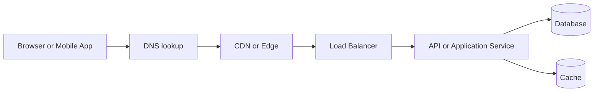
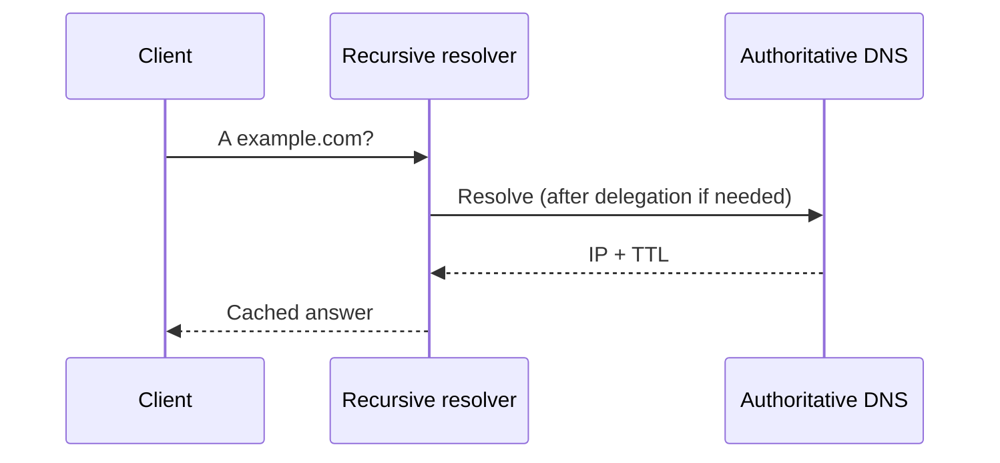
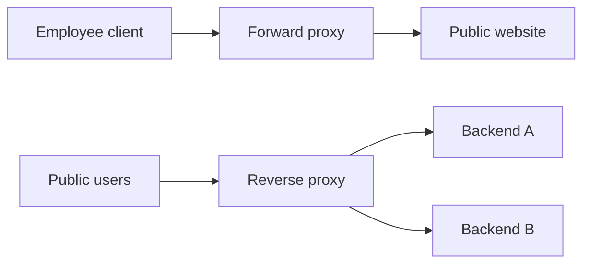
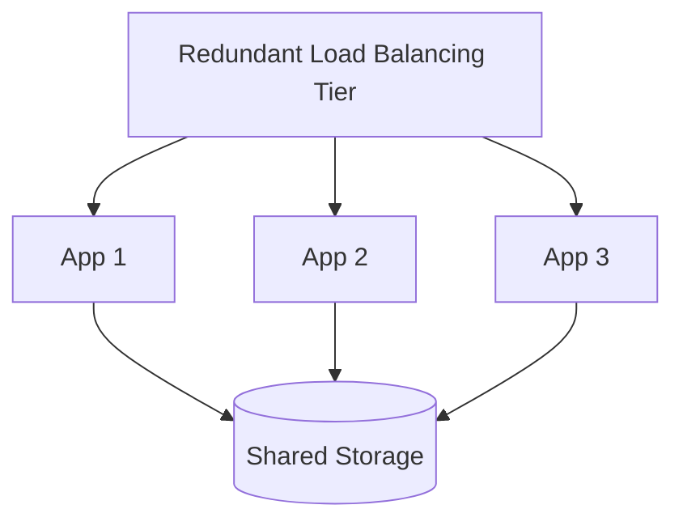
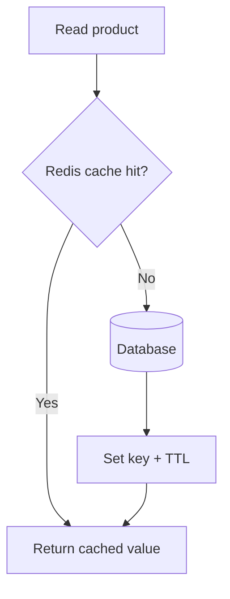
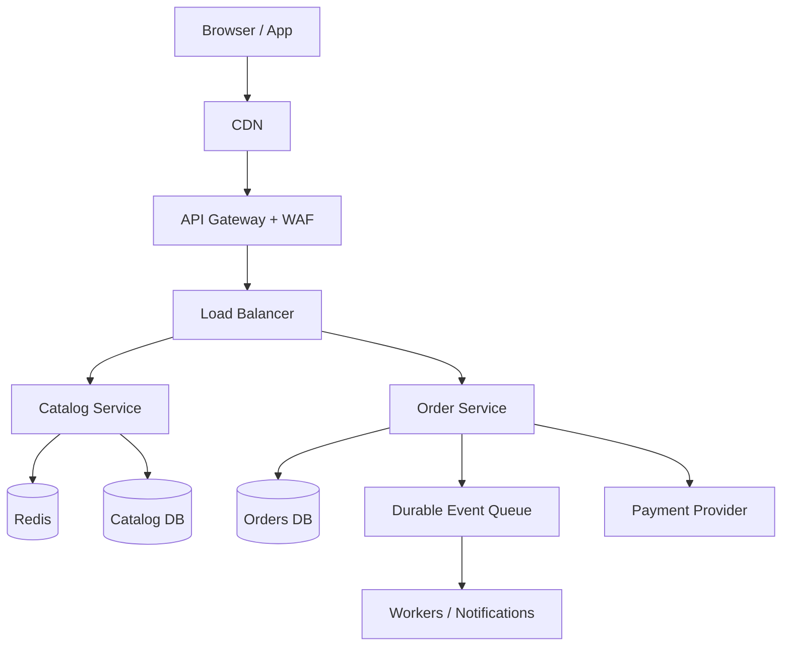

# System Design Master Study Guide

**Networking → API Design → Security → Edge & Load Balancing → Caching → Scalability → Performance → Practical Architecture**

> Based on 19 supplied PDFs. Reorganized and rewritten as a progressive learning guide with corrected nuances, conceptual explanations, examples, diagrams, concise interview answers and revision notes. Examples and targets are illustrative—not claims of production benchmarks.

## How to use this guide

1. Read chapters 1–10 in order to learn the request journey and interfaces.
2. Study chapters 11–14 for scaling and performance trade-offs.
3. Practice chapter 15 as a whiteboard system-design exercise.
4. Read the question bank aloud; aim for a 30–60 second answer followed by one trade-off and one real-world example.
5. Review the flashcards and formula sheet before interviews.

## Table of contents

- [01. System design thinking and client-server fundamentals](#01-system-design-thinking-and-client-server-fundamentals)
- [02. IP addresses, ports and network fundamentals](#02-ip-addresses-ports-and-network-fundamentals)
- [03. DNS resolution and traffic routing](#03-dns-resolution-and-traffic-routing)
- [04. TCP, UDP, TLS and connection behavior](#04-tcp-udp-tls-and-connection-behavior)
- [05. Proxies, CDNs and the edge](#05-proxies-cdns-and-the-edge)
- [06. Load balancing and fault tolerance](#06-load-balancing-and-fault-tolerance)
- [07. RESTful APIs and HTTP contracts](#07-restful-apis-and-http-contracts)
- [08. API gateway, authentication and rate limiting](#08-api-gateway-authentication-and-rate-limiting)
- [09. CORS and browser security](#09-cors-and-browser-security)
- [10. REST, GraphQL, gRPC and real-time communication](#10-rest-graphql-grpc-and-real-time-communication)
- [11. Caching patterns and invalidation](#11-caching-patterns-and-invalidation)
- [12. Scalability, horizontal/vertical/diagonal scaling](#12-scalability-horizontalverticaldiagonal-scaling)
- [13. Autoscaling and cloud operational practices](#13-autoscaling-and-cloud-operational-practices)
- [14. Performance engineering: latency, throughput and monitoring](#14-performance-engineering-latency-throughput-and-monitoring)
- [15. Putting it together: design a product catalog and checkout](#15-putting-it-together-design-a-product-catalog-and-checkout)
- [Quick revision: important comparisons](#quick-revision-important-comparisons)
- [Interview answer framework](#interview-answer-framework)
- [Source document map](#source-document-map)

---

## 01. System design thinking and client-server fundamentals

### Theory and concepts

System design is the process of turning functional needs (what a system does) and nonfunctional needs (how reliably and quickly it does it) into an architecture with explicit trade-offs.

**Mental model:** A restaurant is a system: customers are clients, waiters are API entry points, the kitchen is the application service, storage is the database, and a queue of orders absorbs spikes. A good design handles rush hour without losing orders.

**Client-server request journey:** A browser/mobile client makes an HTTP request; a server authenticates it, applies business logic, reads/writes data and returns a status and payload. Multiple clients can share the same backend; the server can call other services.



**Functional requirements** describe user features (search products, check out). **Nonfunctional requirements** include availability, p95 response time, durability, security, recovery and cost. Define **SLOs** such as 99.9% monthly uptime and p95 read latency below 250 ms before choosing components. SLOs are targets, not facts about any particular architecture.

**Synchronous vs asynchronous:** With synchronous interaction, the caller waits for the result; with asynchronous work, the operation is queued or results are delivered later. An HTTP request itself can be handled asynchronously inside the client and server. Prefer asynchronous processing for tasks such as image processing and bulk email, but not when the user needs an immediate answer.

**Useful numbers (example, not universal):** 1 million requests/day ≈ 11.6 average requests/second. Peak traffic may be many times the average. Estimate payload, peak RPS, read/write ratio and retention separately.

### Key notes to remember

- **Remember:** Clarify traffic patterns, latency SLOs, durability and cost before choosing tools.
- **Remember:** Estimate both average and peak traffic.

### Interview questions and model answers

**Q1. What is system design?**

**Answer:** Defining components, interfaces, storage, deployment and failure behavior to satisfy functional and nonfunctional requirements. Start with requirements and constraints, then estimate load and explain trade-offs.

**Q2. What is the client-server model?**

**Answer:** Clients initiate requests; servers serve resources or operations over network protocols. Multiple application servers may act as a logical backend.

**Q3. What is the difference between functional and nonfunctional requirements?**

**Answer:** Functional describes features; nonfunctional describes measurable qualities such as latency, reliability, scalability, privacy and cost.

**Q4. What happens when a user opens a website?**

**Answer:** The client resolves DNS, establishes a secure connection, sends an HTTP request, traverses proxies or balancers, receives the response and loads additional assets. Some steps may be served from caches.

**Q5. When do you choose asynchronous work?**

**Answer:** When work is slow or can tolerate eventual results. Persist an intent/job, enqueue it, return a tracking ID and design retries plus idempotency.

**Source reading:** Client-Server+Model_+Interview+Questions+and+Answers.pdf; System+Design+-+Updated+-+Section+2.pdf.

---

## 02. IP addresses, ports and network fundamentals

### Theory and concepts

An IP address identifies a network interface for routing packets. **IPv4** uses 32 bits (`203.0.113.10`); **IPv6** uses 128 bits (`2001:db8::1`). A **port** identifies an application endpoint on the host, e.g. HTTPS commonly uses TCP 443. An IP alone does not tell you which service to contact.

**Public/private IP:** RFC 1918 IPv4 private blocks: `10.0.0.0/8`, `172.16.0.0/12`, `192.168.0.0/16`. They are not globally routed on the public internet. **NAT** translates addresses, frequently enabling many private clients to share public IPv4 space. NAT is not itself a substitute for a firewall.

**CIDR:** `/24` in IPv4 means 24 network bits and 8 host bits, totaling 256 addresses before reservations. In a cloud VPC, subnets, routes, NAT gateways, security groups/firewall rules and internet gateways determine reachability. `0.0.0.0/0` matches all IPv4 destinations.

**Practical example:** A public API gateway in a public subnet calls private application pods; those pods reach a private database over internal routing. The database should not require a public IP.

**Important correction:** IPv6 supports IPsec specifications, but IPv6 traffic is *not automatically encrypted*. Apply TLS or IPsec as appropriate.

### Key notes to remember

- **Remember:** Network isolation is defense in depth, not just a private IP.
- **Remember:** Never confuse IP address, hostname and TCP port.

### Interview questions and model answers

**Q1. IPv4 vs IPv6?**

**Answer:** IPv4 has a 32-bit address space; IPv6 has 128 bits. IPv6 changes addressing and neighbor discovery and reduces pressure for IPv4 NAT; it does not guarantee encryption.

**Q2. What is NAT?**

**Answer:** Network Address Translation rewrites IP addresses or ports as traffic crosses a network boundary, commonly sharing a public IPv4 address among private clients.

**Q3. What is CIDR?**

**Answer:** Classless Inter-Domain Routing expresses a network prefix length, e.g., 10.0.1.0/24. It guides subnet allocation and route aggregation.

**Q4. Why place databases in private subnets?**

**Answer:** To reduce internet exposure; restrict connectivity to necessary application components and manage egress and identity independently.

**Source reading:** Interview+Questions+-+IP+addresses.pdf; System+Design+-+Updated+-+Section+2.pdf.

---

## 03. DNS resolution and traffic routing

### Theory and concepts

**DNS** maps human-friendly domain names to records such as `A` (IPv4), `AAAA` (IPv6), `CNAME` (alias), `MX` (mail exchange), `TXT` (metadata) and `NS` (delegation).

**Resolution path:** Browser/OS cache → recursive resolver → root delegation → TLD delegation → authoritative server. The recursive resolver can cache answers according to TTL. The root tells the resolver where the TLD servers are; it does not normally return a website IP.



**TTL** controls how long caches may retain an answer, not an exact guaranteed cutover time. During failover, some clients keep cached addresses. **Geo DNS/weighted routing** can distribute traffic, but DNS does not replace application health checks or per-request balancing.

**Troubleshooting:** `dig example.com A`, `dig example.com AAAA`, inspect TTL, compare public recursive resolvers, verify authoritative nameservers and distinguish DNS errors from TLS or HTTP errors.

### Key notes to remember

- **Remember:** DNS answers are cacheable; TTL is not an instant-switch guarantee.
- **Remember:** A resolver differs from an authoritative nameserver.

### Interview questions and model answers

**Q1. Walk through DNS resolution.**

**Answer:** A client asks a recursive resolver; on a cache miss it follows root and TLD delegations to an authoritative server, caches the answer per TTL, and returns it.

**Q2. Recursive vs authoritative DNS?**

**Answer:** Recursive resolvers find and cache answers for clients; authoritative servers publish the definitive records for their DNS zones.

**Q3. What is DNS TTL?**

**Answer:** Time to live is the maximum cache lifetime signaled for a DNS record; shorter TTL can speed planned migrations but increases query volume.

**Q4. Does DNS load balancing guarantee instant failover?**

**Answer:** No. Cached addresses, resolver behavior and unhealthy endpoints mean DNS-based failover is not instantaneous.

**Source reading:** DNS+Interview+Questions+&+Answers.pdf; System+Design+-+Updated+-+Section+2.pdf.

---

## 04. TCP, UDP, TLS and connection behavior

### Theory and concepts

**TCP** provides a reliable, ordered byte stream with sequencing, acknowledgments, retransmission, congestion control and flow control. **UDP** sends datagrams without built-in delivery, ordering or connection setup guarantees. Higher-level protocols can implement reliability on UDP; **QUIC/HTTP/3** is a notable example.

**TCP three-way handshake:** SYN → SYN-ACK → ACK. **TLS** then establishes an encrypted, authenticated channel (often integrated in the connection setup depending on protocol). TLS prevents passive inspection and verifies the server certificate when validated properly.

**Latency sources:** DNS, connection setup, TLS negotiation, geographic propagation, queueing, server CPU, database locks and payload transfer. Network bandwidth is not interchangeable with latency.

**Examples:** Database access typically uses TCP. Traditional DNS often uses UDP but can use TCP. Modern video delivery uses a variety of protocols, including HTTPS over TCP and HTTP/3 over QUIC/UDP—do not assume all video uses raw UDP.

**Practice:** Explain how a lost TCP segment can cause head-of-line blocking within a stream, and how connection reuse, HTTP/2 multiplexing and HTTP/3 behave differently.

### Key notes to remember

- **Remember:** TCP reliability applies to bytes in a connection, not end-to-end business events.
- **Remember:** QUIC rides on UDP but adds reliability.

### Interview questions and model answers

**Q1. TCP vs UDP?**

**Answer:** TCP guarantees ordered reliable bytes within an active connection; UDP provides best-effort datagrams and leaves reliability/ordering to the application if needed.

**Q2. Why does TCP use a three-way handshake?**

**Answer:** To synchronize connection state and initial sequence numbers before exchanging application bytes.

**Q3. What is TLS?**

**Answer:** A protocol for encryption, integrity and peer authentication, usually authenticating the server via a validated certificate.

**Q4. Can UDP support reliable applications?**

**Answer:** Yes. QUIC adds reliable streams, congestion control and encryption over UDP.

**Source reading:** Interview+questions+-+TCP+and+UDP.pdf; System+Design+-+Updated+-+Section+2.pdf.

---

## 05. Proxies, CDNs and the edge

### Theory and concepts

A **forward proxy** is chosen on the client side to reach destinations, often for enterprise outbound policy, caching or privacy. A **reverse proxy** sits in front of services and accepts inbound requests, adding TLS termination, routing, WAF, caching or rate control. Both are intermediaries, but they serve different trust boundaries.



A **CDN** is a geographically distributed edge network: a nearby PoP serves cacheable images, JavaScript, stylesheets or selected API responses. On a cache miss, the edge fetches from the origin. **Cache-control** headers, TTL, Vary and request keys determine correctness; private user responses must not leak between users.

**CDN patterns:** immutable fingerprinted files with long TTL; short TTL for fast-changing public data; versioned URLs or explicit invalidation for updates; signed URLs for restricted content. A CDN improves edge performance but does not automatically make an uncached origin resilient.

**Analogy:** An origin is a central warehouse; CDN PoPs are local delivery depots. A reverse proxy is the reception desk directing visitors to departments.

### Key notes to remember

- **Remember:** A CDN is a distributed cache, not a substitute for authoritative write logic.
- **Remember:** Reverse proxy represents servers; forward proxy represents clients.

### Interview questions and model answers

**Q1. Forward vs reverse proxy?**

**Answer:** A forward proxy represents clients making outbound requests; a reverse proxy represents backend services receiving inbound requests.

**Q2. How does a CDN reduce latency?**

**Answer:** It serves cacheable assets from geographically close edge servers and reduces repeated origin fetches.

**Q3. What happens on a CDN cache miss?**

**Answer:** The edge forwards to origin or an upstream cache, returns the response and optionally stores it according to caching rules.

**Q4. How do you prevent private responses from CDN caching?**

**Answer:** Use explicit cache policy, suitable Cache-Control directives, correct cache keys, auth checks and testing; never cache user-private responses as public content.

**Source reading:** CDN+System+Design+Interview+Questions+&+Answers.pdf; Interview+Questions+&+Answers_+Forward+Proxy+vs+Reverse+Proxy.pdf; System+Design+-+Updated+-+Section+2.pdf.

---

## 06. Load balancing and fault tolerance

### Theory and concepts

A **load balancer (LB)** distributes eligible requests across healthy backends. It helps throughput and availability, but one misconfigured LB can still become an outage source; use a managed/redundant deployment.

**Layer 4 vs Layer 7:** L4 sees transport attributes such as IP, port and TCP/UDP connections. L7 understands HTTP paths, headers and hostnames and can route `/orders` to one service and `/catalog` to another.

**Algorithms:** Round robin works when capacity/request cost is similar. Least connections can help when connection durations differ, but connection count is not identical to request load (especially with multiplexing). Weighted methods support heterogeneous backends. Consistent hashing can reduce reshuffling for shard or affinity use cases.

**Health checks:** readiness decides whether an instance receives traffic; liveness determines whether it should be restarted. Distinguish overload, degraded dependency and dead process. **Sticky sessions** are sometimes necessary but limit flexibility; prefer externalized session state where practical.



**Failure practice:** Drain connections before deployments, set sensible timeouts, avoid automatic retry storms, and ensure the LB has enough cross-zone capacity.

### Key notes to remember

- **Remember:** Load balancing increases app capacity only if dependencies also scale.
- **Remember:** Distinguish readiness from liveness.

### Interview questions and model answers

**Q1. What problem does a load balancer solve?**

**Answer:** It spreads traffic across healthy instances, enabling horizontal scale and failover from failed instances.

**Q2. L4 vs L7 LB?**

**Answer:** L4 routes based on transport connection details; L7 inspects application HTTP information for fine-grained routing and policies.

**Q3. Round robin vs least connections?**

**Answer:** Round robin rotates requests; least connections favors backends with fewer active connections. Select based on traffic and request characteristics.

**Q4. What is session affinity?**

**Answer:** Routing a user to the same backend. It can simplify legacy state handling but reduces flexibility and may fail when that backend disappears.

**Q5. Are health checks enough for availability?**

**Answer:** No. Also design LB redundancy, dependency resilience, proper capacity, timeouts, failover testing and zone distribution.

**Source reading:** Interview+Questions+&+Answers+on+Load+Balancing.pdf; Interview+Questions+&+Answers+—+Introduction+to+Load+Balancing.pdf; System+Design+-+Updated+-+Section+2.pdf.

---

## 07. RESTful APIs and HTTP contracts

### Theory and concepts

**REST** is an architectural style built on constraints: client-server, stateless, cacheable, layered system, uniform interface and optional code-on-demand. In normal API practice, HTTP resource URLs and methods are used to implement REST-like interfaces.

**Resource examples:** `GET /v1/orders/42`, `POST /v1/orders`, `PATCH /v1/orders/42`, `DELETE /v1/orders/42`. Use nouns for resources and represent business actions explicitly when they are not natural CRUD (e.g., `POST /orders/42/cancellations`).

| Method | Typical use | Safe? | Idempotent by semantics? |
|---|---|---|---|
| GET | Read | Yes | Yes |
| POST | Create/operation | No | No, unless designed with an idempotency key |
| PUT | Replace resource | No | Yes |
| PATCH | Partial update | No | Not guaranteed |
| DELETE | Delete | No | Yes (effect, not necessarily same status) |

**Status codes:** `200` success, `201` created, `202` accepted for asynchronous processing, `204` no body, `400` bad input, `401` unauthenticated, `403` not permitted, `404` absent, `409` conflict, `429` rate limited, `500` internal error, `503` temporarily unavailable.

**Production API checklist:** schema validation, pagination with stable ordering/cursors, authorization on each resource, versioning strategy, timeouts, idempotency keys for payments, structured errors, correlation IDs, OpenAPI docs, rate limiting, backward compatibility and observability.

**Sample:** `POST /payments` with `Idempotency-Key` should safely return the recorded result for retried submissions with the same key and matching payload, rather than charging twice.

### Key notes to remember

- **Remember:** Idempotence describes effect of repetitions, not identical response status.
- **Remember:** Authorize every object, not just every endpoint.

### Interview questions and model answers

**Q1. Explain the REST constraints.**

**Answer:** Client-server, statelessness, cacheability, uniform interface, layered system, and optional code-on-demand.

**Q2. PUT vs PATCH?**

**Answer:** PUT normally replaces a resource representation and is idempotent; PATCH applies partial modifications and may or may not be idempotent.

**Q3. How do you design pagination?**

**Answer:** Prefer cursor-based pagination for changing large data sets; provide a stable sort and opaque cursor, with a maximum page size.

**Q4. How do you prevent duplicate payment writes?**

**Answer:** Use a durable idempotency key scoped to caller/operation, atomic transaction boundaries and a stored outcome for retries.

**Q5. What is 202 Accepted?**

**Answer:** The server accepted a request for processing but has not completed it; return a status resource or job identifier.

**Source reading:** Interview+Questions+&+Answers+on+REST+&+RESTful+API+Design+Principles.pdf.

---

## 08. API gateway, authentication and rate limiting

### Theory and concepts

An **API gateway** is the ingress policy and routing layer for APIs. It may enforce TLS, token validation, tenant-aware quotas, request shaping, logging, routing and response composition. An LB primarily distributes workload; an API gateway primarily enforces application-level API policies. A reverse proxy can implement gateway and LB features; these are roles, not always separate boxes.

**Typical flow:** User → Gateway (validate JWT and rate limit) → services (enforce resource-level authorization) → databases. **Gateway authentication is not a replacement for service authorization**: verify that the caller may access that specific order/account.

**Rate-limit algorithms:** fixed window (simple, boundary bursts), sliding window (smoother), token bucket (controlled bursts) and leaky bucket (smoothed throughput). Send `429 Too Many Requests` and suitable retry guidance when limits are exceeded.

**JWT caution:** Validate signature, algorithm, issuer, audience and expiry; rotate keys and do not trust token claims without verification. TLS protects tokens in transit. Store secrets in a secrets manager rather than source code.

**Failure cases:** A gateway can throttle healthy users by mistake, become a chokepoint or amplify retries. Observe rejection counts, latency and per-route health; test policy deployments safely.

### Key notes to remember

- **Remember:** API gateway is a policy role, not necessarily a dedicated box.
- **Remember:** Rate limits need identity/tenant scoping and trustworthy client IP handling.

### Interview questions and model answers

**Q1. API gateway vs load balancer?**

**Answer:** A gateway manages API-specific controls like auth, quotas, routing and transformations; an LB primarily spreads requests or connections among backends.

**Q2. Where does authorization belong?**

**Answer:** At service/resource boundary as well as appropriate gateway checks; a valid JWT alone does not prove permission to access every object.

**Q3. Token bucket vs sliding window?**

**Answer:** Token bucket permits controlled bursts with refill over time; sliding-window counting enforces a recent-interval limit more smoothly.

**Q4. How do you protect gateway availability?**

**Answer:** Use redundant deployment, sane timeouts, circuit breakers where appropriate, monitoring, capacity tests and safe rollouts.

**Source reading:** API+Gateway+-+Interview+Questions+&+Detailed+Answers.pdf.

---

## 09. CORS and browser security

### Theory and concepts

The browser **same-origin policy** limits script access across scheme, hostname and port. **CORS** is a response-header protocol through which a server opts into cross-origin access in a browser. It is **not** authentication, authorization or a general server-to-server firewall.

**Simple requests** may be sent immediately with an Origin header; the browser decides if JavaScript may access the response. A **preflight** `OPTIONS` request is sent for many requests involving custom headers, methods or non-safelisted content types.

```http
OPTIONS /api/orders HTTP/1.1
Origin: https://app.example.com
Access-Control-Request-Method: POST
Access-Control-Request-Headers: authorization, content-type

HTTP/1.1 204 No Content
Access-Control-Allow-Origin: https://app.example.com
Access-Control-Allow-Methods: POST
Access-Control-Allow-Headers: authorization, content-type
```

**Credentials:** Credentialed browser requests cannot use `Access-Control-Allow-Origin: *` together with `Access-Control-Allow-Credentials: true`. Validate allowed origins, include `Vary: Origin` when appropriate, and enforce CSRF protections for cookie-authenticated write actions.

**Security distinction:** CORS governs whether a script can read a cross-origin response; CSRF involves inducing authenticated cross-site actions. Neither replaces input validation, XSS defenses, session protection or resource authorization.

### Key notes to remember

- **Remember:** CORS does not block direct nonbrowser API requests.
- **Remember:** Treat CSRF and CORS as distinct problems.

### Interview questions and model answers

**Q1. Is CORS a security control for an API?**

**Answer:** It is a browser-enforced cross-origin read policy, not API authentication or protection against clients like curl.

**Q2. When does preflight occur?**

**Answer:** Often for non-safelisted methods, headers such as Authorization, or content types such as application/json.

**Q3. Can wildcard origin be used with credentials?**

**Answer:** Not for credentialed CORS responses. Return an explicit permitted origin and required credentials headers instead.

**Q4. CORS vs CSRF?**

**Answer:** CORS governs browser JavaScript cross-origin response access; CSRF tricks a browser into making an unwanted authenticated action. Handle them separately.

**Source reading:** CORS+&+Web+Security+–+Interview+Questions+&+Answers.pdf.

---

## 10. REST, GraphQL, gRPC and real-time communication

### Theory and concepts

**REST** suits resource-oriented public and enterprise APIs with broad tooling. **GraphQL** lets clients select fields from a typed schema; guard against deep/expensive queries, N+1 resolvers and authorization gaps. **gRPC** uses service definitions (often Protocol Buffers) and commonly HTTP/2; it is useful for typed internal service calls and streaming, though browser constraints and operational tooling matter.

| Style | Strength | Primary caveat |
|---|---|---|
| REST | Simple HTTP semantics and caching | Multiple calls or bulky fixed payloads |
| GraphQL | Flexible client-specific field selection | Query cost, complexity and caching |
| gRPC | Typed contracts and efficient interservice traffic | Browser compatibility and observability/debugging |

**Real-time choices:** Polling is easy but may add delay/load; **long polling** holds a request until new data; **SSE** streams server-to-client events over HTTP; **WebSocket** is persistent full-duplex communication. WebSocket commonly starts with an HTTP/1.1 Upgrade handshake, while alternative bootstrapping exists in HTTP/2/3 ecosystems.

**Message reliability:** Connection persistence alone doesn't guarantee end-to-end exactly-once processing. Implement message IDs, acknowledgements when needed, reconnection, resumable cursors, sequence ordering and durable fan-out where appropriate.

**Use-case:** Admin notifications use SSE; collaborative chat can use WebSockets; simple dashboard can poll; service-to-service low-latency typed calls may use gRPC.

### Key notes to remember

- **Remember:** Pick communication based on latency, directions, data shape and failure semantics.
- **Remember:** Real-time socket does not mean durable messaging.

### Interview questions and model answers

**Q1. REST vs GraphQL vs gRPC?**

**Answer:** REST provides HTTP resource endpoints; GraphQL exposes a queryable schema; gRPC offers typed remote procedure calls and streaming. Choose for client needs and operational constraints.

**Q2. SSE vs WebSocket?**

**Answer:** SSE provides mainly one-way server-to-client event streaming; WebSocket supports bidirectional frames over a long-lived connection.

**Q3. How do you scale WebSockets?**

**Answer:** Plan connection-aware capacity, broker/pub-sub routing, authenticated subscriptions, reconnects, heartbeats and multi-instance fan-out.

**Q4. Does WebSocket guarantee message delivery after disconnect?**

**Answer:** No. Build application-level persistence, replay IDs and acknowledgments if durability is required.

**Q5. What is the GraphQL N+1 problem?**

**Answer:** Resolvers repeatedly request related data per record; fix with batching/DataLoader and suitable join/query design.

**Source reading:** Interview+Questions+-+Real+time+communication.pdf; Interview+questions+-+Beyond+REST.pdf.

---

## 11. Caching patterns and invalidation

### Theory and concepts

Caching stores data in a faster or closer layer, trading freshness/complexity for lower latency and backend load. Layers include browser, CDN, reverse proxy, API response cache, Redis/Memcached and database buffer/result caches.

**Cache-aside:** service reads cache; on miss reads database and populates cache. **Write-through:** write data to cache and primary storage as part of a controlled path (not automatically atomic). **Write-behind:** queue/cache changes for later persistence (needs strong durability design). **Read-through:** a cache integration fetches misses automatically.



**TTL** ages out entries. **LRU** evicts least recently used items; **LFU** evicts least frequently used. **Cache stampede** happens when many requests regenerate one expired hot key; address with request coalescing, jittered TTLs, stale-while-revalidate or admission controls. **Hot keys** can overload one partition.

**Consistency practice:** after product update, commit the database first and invalidate cache; race conditions still exist, so combine TTL, event/CDC refresh, versioned keys or stronger semantics where required. Don't blindly cache sensitive user data.

**Example:** A product page caches price/description briefly in Redis and images in a CDN; stock count may demand a shorter TTL or direct authoritative read at purchase time.

### Key notes to remember

- **Remember:** Cache invalidation must match business freshness guarantees.
- **Remember:** Cache misses and hot keys can overwhelm an origin.

### Interview questions and model answers

**Q1. What is cache-aside?**

**Answer:** On a read miss, load from database and populate cache; writes typically invalidate or update the cached key.

**Q2. Write-through vs write-behind?**

**Answer:** Write-through updates cache and underlying store in the write path; write-behind defers persistence and requires robust durability/recovery to avoid losing acknowledged writes.

**Q3. What is a cache stampede?**

**Answer:** Many concurrent requests miss the same popular key and overload the origin. Use locking/coalescing, staggered expiry or stale-while-revalidate.

**Q4. How do you manage stale data?**

**Answer:** Choose tolerated freshness, TTL, targeted invalidation, versioned keys, event-driven refresh or avoid caching critical reads.

**Q5. What is a hot key?**

**Answer:** One disproportionately popular cached key that overloads a node; consider replication, local caching, request coalescing and skew-aware partitioning.

**Source reading:** Interview+questions++-+Caching+for+Speed+Optimization.pdf; System+Design+-+updated+-+Section+8.pdf.

---

## 12. Scalability, horizontal/vertical/diagonal scaling

### Theory and concepts

**Scalability** means maintaining acceptable behavior as workload or stored data grows. **Vertical scaling** adds CPU/RAM to a machine. **Horizontal scaling** adds machines and partitions requests/data. **Diagonal scaling** uses both at different phases. Horizontal scale is not magically linear: state, serial work, databases and shared locks can limit gains.

**Simple growth architecture:** One application server → LB with multiple stateless servers → Redis/shared sessions → database read replicas → queues for noninteractive tasks → data partitioning/sharding when justified.

**Stateless service** holds no required per-user state solely in one instance; durable sessions/data live externally. This allows any healthy instance to answer any request. **Read replicas** can reduce reads but usually have lag and do not increase write capacity. **Sharding** partitions data across machines by key; it adds operational and query complexity.

**Amdahl's Law intuition:** If 20% of execution time cannot be parallelized, infinite workers still cannot yield over 5× overall speedup. Fix shared bottlenecks before adding nodes.

**When scaling fails:** database saturated, connection pool exhausted, lock contention, fixed third-party API quota, per-key hotspots or globally serialized operations.

### Key notes to remember

- **Remember:** App scale may reveal database bottlenecks.
- **Remember:** Read replica lag is a consistency trade-off.

### Interview questions and model answers

**Q1. Horizontal vs vertical scaling?**

**Answer:** Horizontal adds independent workers; vertical increases resources on an existing node. Horizontal offers potential resilience but introduces distribution overhead.

**Q2. What is diagonal scaling?**

**Answer:** A combination of scaling up and out, often upgrading early capacity and then distributing load across nodes.

**Q3. Why might adding instances not improve performance?**

**Answer:** A shared bottleneck (database, lock, network, quota or serialized code) dominates request time.

**Q4. Do read replicas improve writes?**

**Answer:** Not typically. They offload eligible reads but may lag; write throughput still depends on the primary or storage architecture.

**Q5. When should you shard?**

**Answer:** When data volume or write/load distribution outgrows simpler approaches; shard only after considering query patterns, rebalancing and cross-shard operations.

**Source reading:** Interview+Questions+-+Scaling+strategies.pdf; System+Design+-+updated+-+Section+6.pdf.

---

## 13. Autoscaling and cloud operational practices

### Theory and concepts

**Autoscaling** adjusts compute capacity based on metrics or schedules: scale out under sustained pressure and scale in after demand falls. It is an *elasticity* mechanism, not a replacement for capacity planning or architectural scalability.

**Signals:** CPU saturation is useful for CPU-bound services; request concurrency/RPS for web workloads; queue age and depth per worker for background consumers; custom business metrics for domain-specific demand. Choose a **target utilization** that leaves headroom.

**Cloud examples:** AWS EC2 Auto Scaling with CloudWatch, ECS/EKS scaling; Azure VM Scale Sets and AKS HPA; GCP Managed Instance Groups, GKE HPA and Cloud Run scaling. Cap min/max capacity, estimate startup/warm-up time, and maintain multi-zone resilience.

**Autoscaling pitfalls:** scaling too late; oscillation from narrow thresholds; cold starts; database max connections increasing with each instance; scale-in dropping in-flight jobs; quotas preventing scale-out. Use cooldown/stabilization, graceful draining, prewarming for predictable campaigns and load tests.

**Cost example:** 20 always-on workers may cost more than scaling from 4 to 20 during peak hours, but overaggressive scale-in can increase p99 latency. Optimize cost subject to SLOs, not independently.

### Key notes to remember

- **Remember:** Scaling takes time; keep spare capacity for sudden spikes.
- **Remember:** Scale-in must drain work safely.

### Interview questions and model answers

**Q1. Autoscaling vs scalability?**

**Answer:** Scalability is a system property; autoscaling is automatic capacity adjustment within that system.

**Q2. Best metrics for queue worker autoscaling?**

**Answer:** Use queue age or backlog per worker alongside processing rate and resource limits; queue length alone can be misleading.

**Q3. What is scaling thrash?**

**Answer:** Rapid alternating scale-out and scale-in; mitigate with stabilization windows, hysteresis and sensible thresholds.

**Q4. What must scale-in handle?**

**Answer:** Stop taking new work, drain in-flight requests/jobs and protect at-least-once message delivery plus idempotent processing.

**Source reading:** Interview+questions+-+Autoscaling+&+Cloud+Best+Practices.pdf; System+Design+-+updated+-+Section+6.pdf.

---

## 14. Performance engineering: latency, throughput and monitoring

### Theory and concepts

**Latency** is elapsed time per request; **throughput** is completed work per unit time. A design can deliver high throughput with slow per-user responses when queues grow. Track **p50/p95/p99** latencies, not only average; report the observation window and traffic pattern.

**Little's Law:** L = λ × W, where L is average number of requests in the system, λ is average throughput and W is mean time in system *under stable conditions*. If 200 requests/s each spend 0.25 s end-to-end, average concurrency ≈ 50.

**Optimization hierarchy:** Establish baseline → identify slow path with traces → look at database plans/locks → reduce excessive round trips → use indexing/batching/caching → tune workers and autoscaling → load test and verify tail latency. Do not add Redis by reflex when the bottleneck is CPU or an external provider.

**Golden signals:** latency, traffic, errors and saturation. Add business-specific metrics and dependency-specific dashboards. **Distributed tracing** connects calls with a trace ID; **metrics** show trends; **logs** explain events. Redact sensitive fields.

**Testing:** load tests assess target traffic; stress tests find breaking point; spike tests assess sharp bursts; soak tests detect leaks over time. Model realistic payloads, cache state, request mixes and database sizes.

**Resilience:** deadlines/timeouts, retries with jitter and caps, circuit breakers where useful, bulkheads, load shedding, bounded queues, graceful degradation. Retries are safe only if the operation semantics allow them.

### Key notes to remember

- **Remember:** Track percentiles and queueing under realistic load.
- **Remember:** Never optimize without measuring baseline.

### Interview questions and model answers

**Q1. Latency vs throughput?**

**Answer:** Latency is time per request; throughput is requests processed per time. Neither alone measures system quality.

**Q2. Why use p95 or p99 instead of average?**

**Answer:** Tail percentiles reveal slow experiences hidden by averages; p99 is the value at or below which 99% of measured requests fall.

**Q3. Explain Little’s Law.**

**Answer:** For stable flow, average work-in-progress L equals throughput λ times average time W: L = λW.

**Q4. What is a cache or database bottleneck diagnostic approach?**

**Answer:** Measure request traces and saturation, compare hit rate/queries/plans and fix the measured constraint rather than guessing.

**Q5. Why can retries cause outages?**

**Answer:** Retries add traffic during failures and amplify overload; cap attempts with backoff+jitter, timeouts and idempotency.

**Source reading:** System+Design+-+updated+-+Section+8.pdf.

---

## 15. Putting it together: design a product catalog and checkout

### Theory and concepts

**Scenario:** Design an ecommerce product catalog and checkout supporting 1M requests/day average and unpredictable flash-sale peaks. Treat all numbers below as *illustrative assumptions* to validate in an interview.

**Requirements:** browse/search products, product detail, inventory check, create order, payment response; p95 detail-page response below 300 ms and no duplicate payment. Nonfunctional goals: fault isolation, visibility and secure access.



**Read path:** CDN serves assets → gateway enforces policy → catalog service checks Redis and then database. **Write path:** checkout validates inventory, creates an order transaction, handles payment idempotently, stores order outcome and publishes asynchronous events through an outbox or similarly reliable mechanism. Avoid treating queue publication and DB commit as magically atomic.

**Growth plan:** start with stateless replicated services and one primary database; add indexes and cache by measured hot paths; offload background tasks; employ read replicas and partitioning only when supported by access patterns; scale with queue age/RPS plus connection-pool limits.

**Failure drills:** Redis unavailable → bounded fallback to DB; payment timeout → do not charge again blindly, reconcile with idempotency key; worker crashes → safe redelivery; one AZ unavailable → load balancer routes healthy instances; CDN serves stale item → ensure inventory/checkout uses authoritative information.

**Interview structure:** (1) Clarify scope; (2) size traffic/data; (3) define API/data model; (4) draw high-level blocks; (5) deep dive bottlenecks; (6) availability, security and trade-offs; (7) monitoring and cost.

### Key notes to remember

- **Remember:** Always explain failure modes and correctness for money/inventory.
- **Remember:** Start simple and add complexity only where measured.

### Interview questions and model answers

**Q1. Design a product detail page for flash-sale traffic.**

**Answer:** Put static assets on CDN, cache popular product reads, enforce rate limits, use stateless app nodes and monitor hit rate, DB capacity and p95/p99. Inventory checks require stronger correctness.

**Q2. How do you avoid duplicate orders on retries?**

**Answer:** Use a client idempotency key persisted with a unique constraint/transaction, return prior outcome for repeat requests and reconcile uncertain payment states.

**Q3. How would you defend the system during a sudden spike?**

**Answer:** CDN, gateway quotas, queueing/load shedding, autoscaling with prewarming and gracefully reduced noncritical features, while protecting the database.

**Q4. What would you monitor?**

**Answer:** RPS, error rate, p95/p99, CPU/memory, DB connection pool and slow queries, cache hit rate, queue oldest-message age, payment success and user conversion.

**Source reading:** System+Design+-+Updated+-+Section+2.pdf; System+Design+-+updated+-+Section+6.pdf; System+Design+-+updated+-+Section+8.pdf.

---

## Quick revision: important comparisons

| Concept A | Concept B | Essential difference |
|---|---|---|
| Latency | Throughput | Per-request delay vs requests/second |
| Horizontal scale | Vertical scale | More nodes vs stronger node |
| L4 load balancing | L7 load balancing | Transport-aware vs HTTP/content-aware |
| Gateway | Load balancer | API policies/routing vs distribution among healthy backends |
| Forward proxy | Reverse proxy | Represents clients vs backends |
| TCP | UDP | Ordered reliable byte stream vs best-effort datagrams |
| WebSocket | SSE | Bidirectional vs server-to-client streaming |
| REST | GraphQL | Resource-oriented endpoints vs client-selected schema fields |
| Cache-aside | Write-through | Populate on demand vs coordinate cache and DB on writes |
| Availability | Reliability | Can be accessed now vs continues functioning correctly over time |
| Authentication | Authorization | Who are you? vs what may you do? |
| CORS | CSRF | Cross-origin response read policy vs unwanted authenticated actions |

### Formulas worth remembering

- **Average RPS** = requests per day / 86,400. Example: 1,000,000 / 86,400 ≈ 11.6 RPS.
- **Little’s Law**: `L = λ × W` for stable flow (average concurrency = throughput × average time).
- **Availability**: `(total time – downtime) / total time × 100%`.
- **Cache hit rate**: `hits / (hits + misses) × 100%`.
- **Error rate**: failed requests / total requests (define failure policy).
- **Amdahl upper bound**: speedup ≤ `1 / (s + (1 – s)/N)` where `s` is the serial fraction and `N` the parallel workers.

## Interview answer framework

**60-second answer:** (1) Define simply; (2) describe request/data flow; (3) give a real example; (4) mention a limitation; (5) say how to monitor it.

**Architecture round (30–45 minutes):** requirements → assumptions/scale estimates → APIs/data model → high-level sketch → deep dive one bottleneck → resilience/security → trade-offs → monitoring.

**Common interviewer follow-ups:** What if 10× traffic arrives? What if the cache fails? What if a user retries? What if one region goes down? How do you verify p99? What does it cost?

## Source document map

The following 19 files were supplied for this guide; overlapping interview questions have been consolidated into the relevant chapters rather than copied indiscriminately.

1. `API+Gateway+-+Interview+Questions+&+Detailed+Answers.pdf` (5 pages)
2. `CDN+System+Design+Interview+Questions+&+Answers.pdf` (6 pages)
3. `CORS+&+Web+Security+–+Interview+Questions+&+Answers.pdf` (5 pages)
4. `Client-Server+Model_+Interview+Questions+and+Answers.pdf` (6 pages)
5. `DNS+Interview+Questions+&+Answers.pdf` (3 pages)
6. `Interview+Questions+&+Answers+on+Load+Balancing.pdf` (6 pages)
7. `Interview+Questions+&+Answers+on+REST+&+RESTful+API+Design+Principles.pdf` (6 pages)
8. `Interview+Questions+&+Answers+—+Introduction+to+Load+Balancing.pdf` (4 pages)
9. `Interview+Questions+&+Answers_+Forward+Proxy+vs+Reverse+Proxy.pdf` (6 pages)
10. `Interview+Questions+-+IP+addresses.pdf` (6 pages)
11. `Interview+Questions+-+Real+time+communication.pdf` (6 pages)
12. `Interview+Questions+-+Scaling+strategies.pdf` (4 pages)
13. `Interview+questions++-+Caching+for+Speed+Optimization.pdf` (4 pages)
14. `Interview+questions+-+Autoscaling+&+Cloud+Best+Practices.pdf` (3 pages)
15. `Interview+questions+-+Beyond+REST.pdf` (6 pages)
16. `Interview+questions+-+TCP+and+UDP.pdf` (5 pages)
17. `System+Design+-+Updated+-+Section+2.pdf` (66 pages)
18. `System+Design+-+updated+-+Section+6.pdf` (30 pages)
19. `System+Design+-+updated+-+Section+8.pdf` (53 pages)

## Suggested seven-day preparation schedule

| Day | Focus | Practice |
|---|---|
| 1 | Client-server, IP, DNS | Trace a website request end to end |
| 2 | TCP/UDP, proxies, CDN | Explain latency and caching |
| 3 | Load balancing and REST | Design health checks and pagination |
| 4 | Gateway, CORS, auth | Debug a failed browser API call |
| 5 | gRPC/GraphQL/WebSocket, caching | Pick protocol and cache strategy |
| 6 | Scaling, autoscaling, performance | Calculate RPS and diagnose p99 |
| 7 | Complete mock | Design catalog + checkout; explain failures |

---

*Prepared as an independent learning synthesis of the supplied material. Product-specific behavior and deployment settings should be verified against current vendor documentation for production use.*
